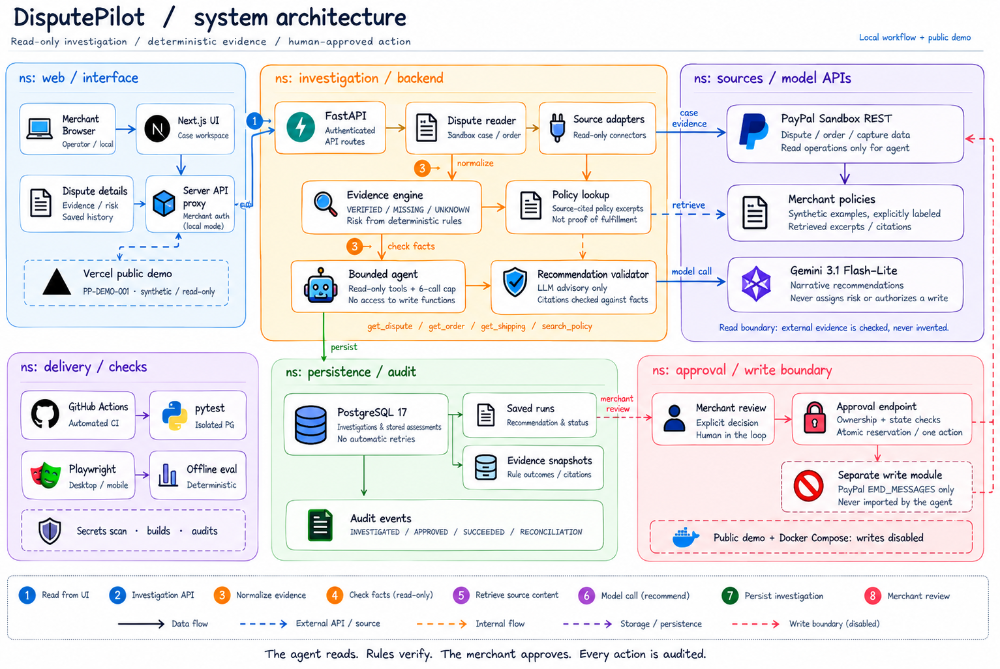

# DisputePilot

DisputePilot is a human-in-the-loop PayPal Sandbox dispute investigation workspace.
It collects case evidence, applies deterministic rules, asks Gemini for a grounded
recommendation, and presents the result for merchant review.

The model does not assign risk or authorize actions. Risk and evidence status come
from application rules, model citations are validated against known fact IDs, and
the agent cannot import the write module. The only implemented PayPal write is a
fixed Sandbox message sent after explicit merchant approval.



## What it demonstrates

- Read-only retrieval of PayPal Sandbox dispute and capture data.
- Deterministic evidence facts, rule outcomes, risk, and review requirements.
- A bounded Gemini agent with four read-only tools.
- Grounded `CONTEST`, `REFUND`, or `NEEDS_REVIEW` recommendations.
- Saved investigations, evidence snapshots, and audit history in PostgreSQL.
- A separate approval boundary with ownership, state, eligibility, and duplicate checks.
- A synthetic, read-only public demo that requires no PayPal, Gemini, or database credentials.
- Offline safety evaluation, browser tests, isolated database tests, secret scanning,
  dependency checks, and container builds in CI.

## Architecture

```text
Browser
  -> Next.js workspace and server-side API proxy
    -> FastAPI authenticated routes
      -> PayPal Sandbox read APIs
      -> deterministic evidence engine
      -> bounded read-only agent -> Gemini
      -> PostgreSQL runs and audit events

Merchant approval
  -> dedicated FastAPI approval endpoint
    -> atomic PostgreSQL reservation
      -> separate PayPal Sandbox write module
```

The investigation agent can call only:

- `get_dispute`
- `get_order`
- `get_shipping`
- `search_policy`

It is limited to 6 tool calls, 4 iterations, and 20 seconds. Tool responses and
policy text are treated as untrusted data. If the model call, tool loop, or output
validation fails, the application returns `NEEDS_REVIEW`.

The recommendation validator accepts only evidence fact IDs and policy references
produced by the application. Supporting and adverse citations are checked against
deterministic rule outcomes. Missing information is derived in Python, not trusted
from model output.

## Safety model

DisputePilot separates investigation from execution:

1. The backend reads the current PayPal dispute and related capture data.
2. Deterministic rules classify facts as `VERIFIED`, `MISSING`, or `UNKNOWN` and
   calculate `LOW`, `MEDIUM`, or `HIGH` risk.
3. The agent explains the evidence and recommends an outcome without write access.
4. The result and tool trace are persisted for review.
5. A merchant reviews the exact saved action and confirms it explicitly.
6. The approval endpoint rechecks merchant ownership, run state, current PayPal
   state, action eligibility, and prior execution before reserving one attempt.
7. Only the separate write module can send the fixed Sandbox message.

`PAYPAL_WRITES_ENABLED` defaults to disabled. Docker Compose pins it to `false`,
and the public demo rejects every mutation. Ambiguous write outcomes remain reserved
for manual reconciliation and are never retried automatically. See
[`backend/APPROVAL.md`](backend/APPROVAL.md) for the approval contract and recovery
rules.

## Technology

| Layer | Implementation |
| --- | --- |
| Frontend | Next.js 16, React 19, TypeScript, Playwright |
| Backend | Python 3.11, FastAPI, Pydantic |
| Model | Gemini 3.1 Flash-Lite through `google-genai` |
| Data | PostgreSQL 17 with `psycopg` |
| External API | PayPal Customer Disputes and Payments Sandbox APIs |
| Delivery | Docker Compose, GitHub Actions, optional Vercel public demo |

## Public read-only demo

Set `DISPUTEPILOT_PUBLIC_DEMO=true` before starting or building the frontend. The
home page accepts only `PP-DEMO-001` and also links directly to the sample case.

The sample is defined in `frontend/lib/public-demo.ts`. Its dispute, evidence,
recommendation, tool trace, policies, and audit history are synthetic and visibly
labeled. Public mode:

- makes no PayPal, Gemini, database, or backend request;
- exposes no merchant credential;
- rejects mutation methods;
- returns 404 for unsupported dispute IDs and operations;
- fails closed without attempting an upstream lookup.

Run it locally:

```sh
cd frontend
npm ci
DISPUTEPILOT_PUBLIC_DEMO=true npm run dev
```

Open `http://localhost:3000/`.

For Vercel, use `frontend` as the root directory, Node.js 24, `npm ci`, and
`npm run build`. Set `DISPUTEPILOT_PUBLIC_DEMO=true` for every deployed environment.
Do not configure PayPal, Gemini, database, or merchant credentials in the public
demo project.

## Local Sandbox setup

### Prerequisites

- Docker Engine with Docker Compose.
- PayPal Sandbox business REST credentials.
- A local merchant identity and a random bearer token of at least 32 characters.
- A Gemini API key only when model-backed investigations are needed.

Copy the example environment file once, then fill the placeholders locally:

```sh
cp .env.example .env
```

Required Compose values:

| Variable | Purpose |
| --- | --- |
| `PAYPAL_CLIENT_ID` | PayPal Sandbox REST application ID |
| `PAYPAL_CLIENT_SECRET` | PayPal Sandbox REST application secret |
| `PAYPAL_BASE_URL` | Must remain a permitted PayPal Sandbox origin |
| `DEV_MERCHANT_ID` | Local identity stored in runs and audit events |
| `DEV_MERCHANT_TOKEN` | Server-side development bearer credential |
| `COMPOSE_POSTGRES_PASSWORD` | Password for the Compose PostgreSQL service |

Optional investigation values:

| Variable | Default | Purpose |
| --- | --- | --- |
| `GEMINI_API_KEY` | empty | Enables Gemini requests when the agent flag is enabled |
| `GEMINI_MODEL` | `gemini-3.1-flash-lite` | Model used for recommendations |
| `GEMINI_AGENT_ENABLED` | `false` | Enables the bounded tool-calling agent |

Secrets stay in `.env`, which is ignored by Git. The browser never receives the
merchant token, PayPal secret, Gemini key, or database URL.

### Start with Docker Compose

```sh
docker compose config --quiet
docker compose up --build -d --wait
docker compose ps
```

Open `http://localhost:3000/` and enter a PayPal Sandbox dispute ID.

Only the frontend is published, on `127.0.0.1:3000`. The backend and PostgreSQL
remain on the Compose network. PostgreSQL readiness gates the backend, and frontend
startup waits for the backend health check.

Stop the services without deleting stored investigations:

```sh
docker compose down
```

The `disputepilot-demo_postgres_data` volume persists runs and audit history. Do
not remove it as a troubleshooting step. Losing the database also loses the local
approval history used to block repeat execution.

### Run services natively

Install Python dependencies into a virtual environment and configure `DATABASE_URL`
for a local PostgreSQL database:

```sh
python3.11 -m venv .venv
.venv/bin/python -m pip install -r requirements.txt -c backend/requirements.lock
.venv/bin/python -m backend.database
.venv/bin/python -m uvicorn backend.main:app --host 127.0.0.1 --port 8000
```

In another terminal:

```sh
cd frontend
npm ci
npm run dev
```

The Next.js server loads the repository-root `.env` and attaches the merchant token
to approved upstream requests. Both development servers bind to loopback. This is
development authentication, not production merchant identity or authorization.

## Application flow

From the home page, open a dispute by its Sandbox ID. The workspace displays case
metadata, deterministic evidence and risk, saved investigations, policy excerpts,
agent activity, and audit events.

Starting an investigation creates and persists one run. It does not contact the
write endpoint. Selecting an older run reads its saved result without invoking
Gemini again.

The approval UI shows the exact persisted action and requires an explicit checkbox.
Approval currently supports only `SEND_MESSAGE`; it does not submit evidence,
accept a claim, issue a refund, or automatically resolve a dispute.

## API surface

| Method | Path | Purpose |
| --- | --- | --- |
| `GET` | `/api/disputes/{id}` | Read sanitized dispute details |
| `GET` | `/api/disputes/{id}/assessment` | Build deterministic evidence and risk |
| `GET` | `/api/disputes/{id}/history` | Read merchant-owned runs and audit events |
| `POST` | `/api/disputes/{id}/investigate` | Create a persisted investigation |
| `POST` | `/disputes/{id}/approve` | Confirm and execute the supported saved action |

Investigation, history, and approval routes require the development merchant bearer
credential. Browser requests use the same-origin Next.js proxy, which allows only
the fixed operations above, validates response shapes, refuses redirects, and adds
credentials server-side.

## Verification

Backend checks from the repository root:

```sh
.venv/bin/python -m compileall -q backend spike evaluation tests
.venv/bin/python -m pytest -q
.venv/bin/python -m evaluation.run_evaluation --check
```

Frontend checks:

```sh
cd frontend
npm run typecheck
npm run lint
npm test
npm run build
```

Playwright runs both the local mock-backend suite and the credential-free public
demo suite. Set `PLAYWRIGHT_CHROMIUM_EXECUTABLE` to a compatible installed browser,
or install Chromium through Playwright.

Database integration tests require a dedicated disposable PostgreSQL database named
`disputepilot_approval_test`, `TEST_DATABASE_URL`, and
`DISPUTEPILOT_TEST_ISOLATED=true`. Without that configuration, those tests skip.
Never point them at a development or Compose application database.

The stored offline evaluation covers 12 synthetic scenarios and validates
deterministic expectations, grounded recommendation handling, fallback behavior,
and agent safety checks without external calls. See
[`evaluation/REPORT.md`](evaluation/REPORT.md) and
[`evaluation/README.md`](evaluation/README.md). The live report is a bounded
historical benchmark, not a general model-accuracy claim.

## Repository layout

```text
backend/       FastAPI routes, evidence rules, agent, persistence, approval boundary
frontend/      Next.js workspace, server proxy, public demo, Playwright tests
evaluation/    Synthetic scenarios and offline/live evaluation reports
policies/      Synthetic merchant policy fixtures used for demonstration
spike/         Initial PayPal Sandbox read experiments
tests/         Backend, safety, approval, and evaluation tests
compose.yaml   Local three-service deployment
```

## Limits

- PayPal access is Sandbox-only. Production PayPal origins are rejected.
- The included policy files are synthetic examples, not merchant contracts.
- The public demo contains no live dispute or model output.
- Local bearer authentication is not suitable for a public multi-merchant service.
- The write checkpoint supports only one fixed dispute message.
- A database reservation prevents repeat attempts in one deployment, but it cannot
  provide an atomic transaction with PayPal or cross-deployment idempotency.
- Model validation and synthetic evaluations reduce risk but do not prove factual
  correctness or production readiness.

## License

MIT. See [`LICENSE`](LICENSE).
